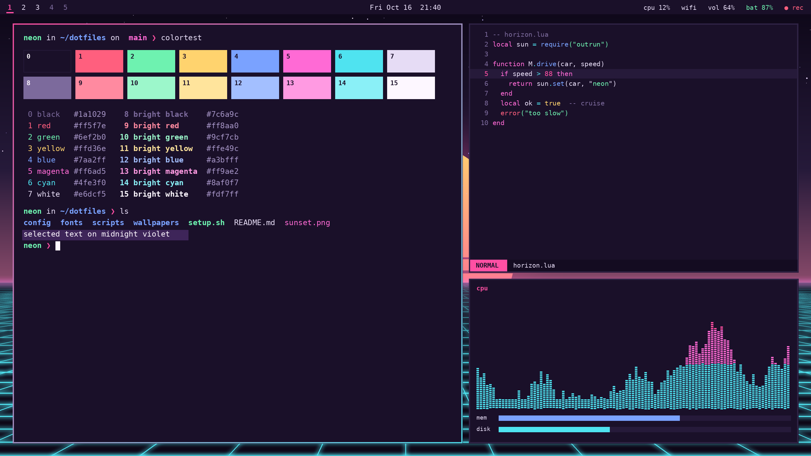
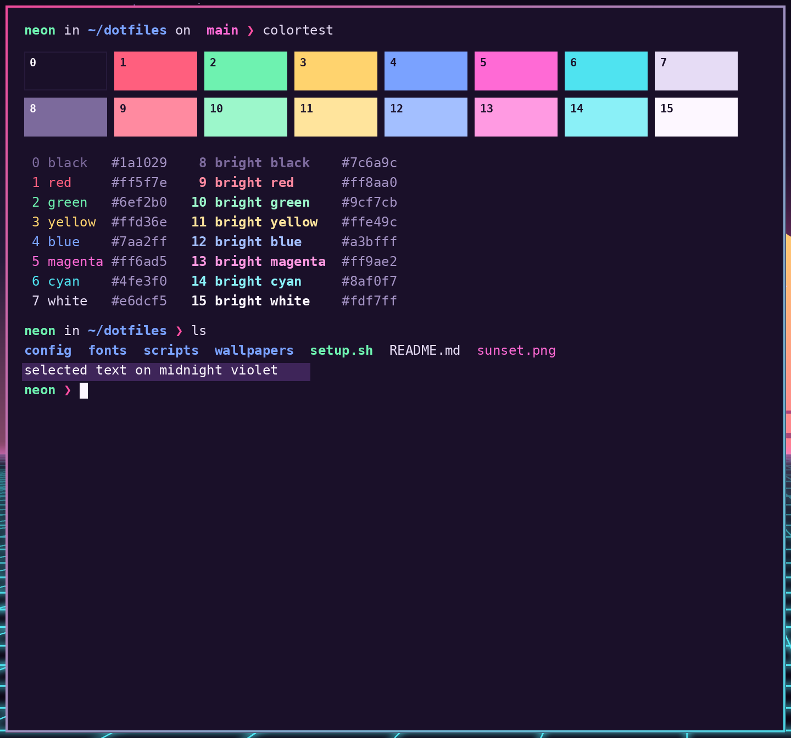
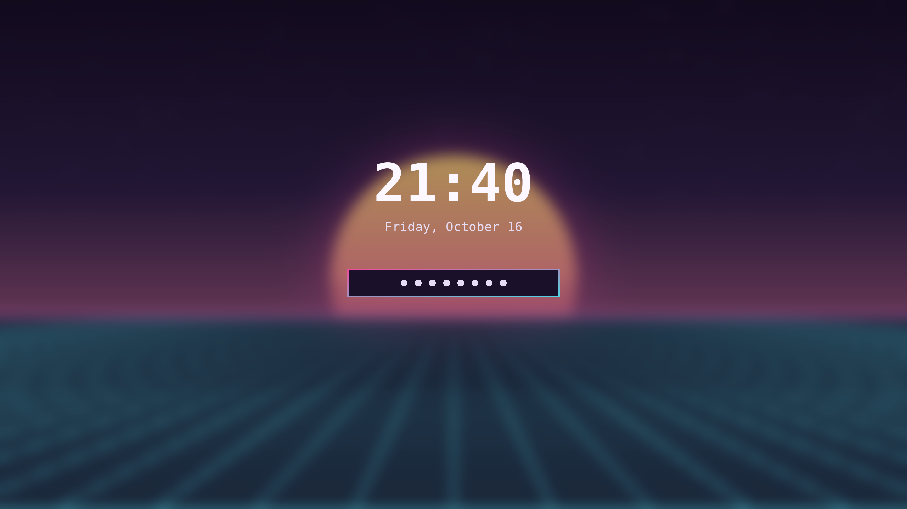

# Neon Horizon

Synthwave after dark: a deep midnight purple base under a hot pink sun, with neon cyan grid lines and magenta glow.

**Version:** 0.1.0 · **For:** Omarchy (Hyprland) 4.0+ · **Mode:** dark



## Screenshots

| Terminal + editor | Lock screen |
|---|---|
|  |  |

## What it themes

Omarchy 4 renders every app config from `colors.toml`, so this theme ships a palette rather than
per-app files. Switching to it colours:

- **Hyprland** window borders: a sunset gradient (`#ff4fa3` to `#4fe3f0`, 45°) on the active window, dim violet on inactive ones
- **Omarchy shell**: top bar, menus, launcher, notifications, OSD, polkit prompt and lock screen (the lock and polkit borders reuse the sunset gradient)
- **Terminals**: Alacritty, Ghostty, Kitty and Foot (all 16 ANSI colours)
- **Editors**: Neovim (aether), Helix, VS Code/Cursor (generated theme), Obsidian
- **btop**: a hand-tuned `btop.theme` with cyan-to-pink CPU, memory and process graphs and blue-cyan network graphs
- **Chromium/Brave** toolbar colour, the keyboard backlight (hot pink where supported), fcitx5, gum, and the other templated apps
- **GTK icons**: `Yaru-magenta`, whose pink accent matches the sun
- **Wallpapers**: three 4K (3840x2160) images in `backgrounds/`, all in the theme's own colours: `1-neon-horizon` (default, a gold-to-pink sun over a cyan grid), `2-afterglow` (the sun on a bare horizon) and `3-magenta-grid` (a cyan sun over a pink grid)

## Theme files

| File | Purpose |
|---|---|
| `colors.toml` | The palette. Omarchy renders Hyprland, terminal, shell, editor and app configs from it |
| `btop.theme` | Colour-only btop override with neon graphs (kept by every install method) |
| `icons.theme` | GTK icon theme name (`Yaru-magenta`) |
| `backgrounds/` | Wallpapers (`1-neon-horizon.png` is the default) |
| `preview.png` | Theme picker preview |
| `screenshots/` | Images for this README |
| `install.sh`, `uninstall.sh` | Optional installer for the release tarball |

## Palette

| Role | Hex | | Role | Hex |
|---|---|---|---|---|
| background | `#1a1029` | | foreground | `#e6dcf5` |
| dark_background | `#140c21` | | light_foreground | `#f0e8fb` |
| darker_background | `#0d0717` | | bright_foreground / cursor | `#fdf7ff` |
| lighter_background | `#261a3a` | | dark_foreground | `#a493c4` |
| selection | `#3e2559` | | muted (comments, bright black) | `#7c6a9c` |
| accent (hot pink) | `#ff4fa3` | | orange / brown | `#ff9a5c` / `#8a4b6b` |
| border active | `#ff4fa3` → `#4fe3f0` | | border inactive | `#3a2d52` (aa alpha) |

| ANSI | Normal | Bright |
|---|---|---|
| black | `#1a1029` (0) | `#7c6a9c` (8) |
| red | `#ff5f7e` (1) | `#ff8aa0` (9) |
| green | `#6ef2b0` (2) | `#9cf7cb` (10) |
| yellow | `#ffd36e` (3) | `#ffe49c` (11) |
| blue | `#7aa2ff` (4) | `#a3bfff` (12) |
| magenta | `#ff6ad5` (5) | `#ff9ae2` (13) |
| cyan | `#4fe3f0` (6) | `#8af0f7` (14) |
| white | `#e6dcf5` (7) | `#fdf7ff` (15) |

All text colours reach at least 4.5:1 against the background. Bright black `#7c6a9c` is 3.8:1 and is meant
for comments and dim text. ANSI 0 is the background itself, the Omarchy convention.

## Requirements

- Omarchy 4.0 or newer (Omarchy 4 renders app configs from `colors.toml`)
- `git` (for the git and `omarchy-theme-install` methods)
- Optional: icon theme `Yaru-magenta` (named in `icons.theme`)
- No root access needed

## Install

Pick one method.

**1. Omarchy's installer (recommended)**

```bash
omarchy-theme-install https://github.com/synthalorian/omarchy-neon-horizon-theme
```

**2. Git clone into the themes folder**

```bash
git clone https://github.com/synthalorian/omarchy-neon-horizon-theme ~/.config/omarchy/themes/neon-horizon
omarchy-theme-set neon-horizon
```

**3. Release tarball with the bundled installer** (backs up any existing theme of the same name and writes a manifest)

```bash
tar -xzf neon-horizon-0.1.0.tar.gz
cd neon-horizon
./install.sh --dry-run   # preview
./install.sh --apply     # install and switch to it
```

Checksum: `sha256sum -c neon-horizon-0.1.0.tar.gz.sha256`

**4. Copy it by hand** (a plain copy without `.git` counts as your own theme, so Omarchy uses every file)

```bash
cp -r neon-horizon ~/.config/omarchy/themes/neon-horizon
omarchy-theme-set neon-horizon
```

> Themes installed with git (methods 1 and 2) only take colour files: Omarchy ignores `*.lua`, terminal
> configs and `vscode.json` from git repos for safety. This theme puts everything into `colors.toml`, so
> every method gives the same result.

## Uninstall

- Installed with method 1, 2 or 4: switch to another theme, then `omarchy-theme-remove neon-horizon`
- Installed with method 3: `./uninstall.sh` (switches away if the theme is active, removes only the files it added and restores your backup). Use `./uninstall.sh --dry-run` to preview.

## Changelog

See [CHANGELOG.md](CHANGELOG.md).

## License

MIT © 2026 synthalorian. See [LICENSE](LICENSE).

## Credits

- Design and packaging: synthalorian
- Thanks to the aether.nvim project, whose colorscheme Omarchy uses to theme Neovim
- Wallpapers: original artwork by synthalorian (MIT, same as the theme)
- Built for [Omarchy](https://omarchy.org) by DHH and contributors
